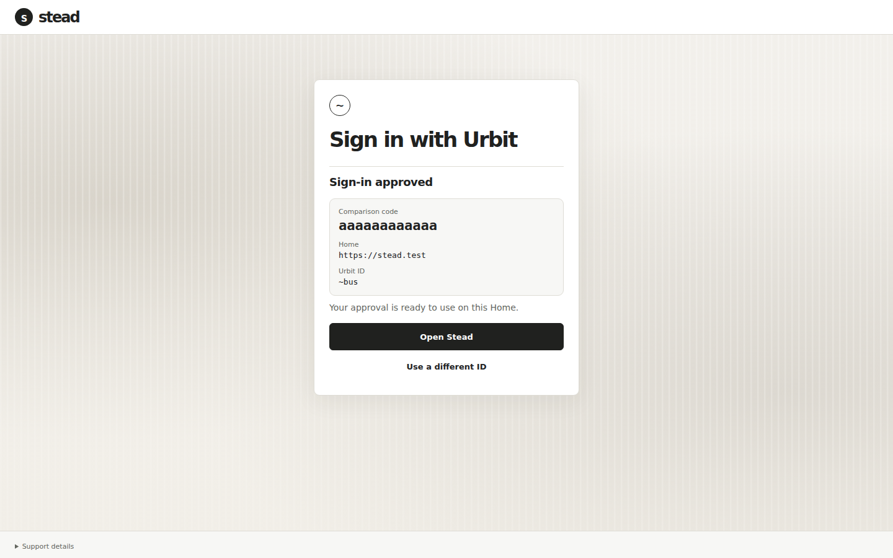
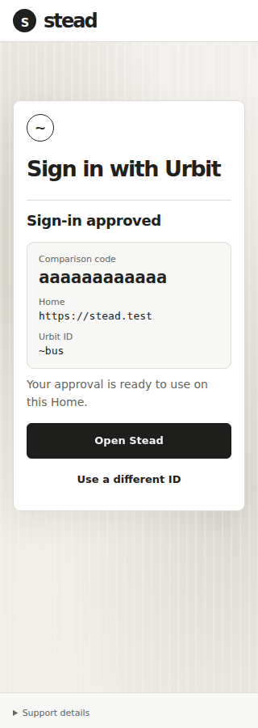

# Member approval recovery — synthetic rendered evidence

The real React client at `dc870a612f1a03db9ef7f2f02a9a9da4425ee499`
passed its [hosted approval check](https://github.com/ScottTpirate/stead-urbit/actions/runs/45744666435).
TypeScript and the production build passed. At 1440 and 320 pixels the fixture
exercised denied start, observed approval without automatic consumption, expiry,
new-code retry, unavailable checking, a terminal manual check and keyboard return.
The [Activity regression](https://github.com/ScottTpirate/stead-urbit/actions/runs/45744666545)
also passed on this source.

The latest original ZIP and both PNG bytes were independently verified. The
screenshots use a synthetic Home and invented member; they contain no private
pilot or participant data. They show the approved state, with the exact Home and
comparison still visible and an explicit **Open Stead** action. The later manual
expiry regression does not change these screenshot bytes.

The [receipt](../member-approval-recovery.json) retains the source, run, original
artifact hashes, prior capture and independent review. T27 remains in progress:
browser-only invitations, an independent member journey and deployment of this
client remain open. This rendered check does not renew a native grant or qualify
the named pilot's current member session.
